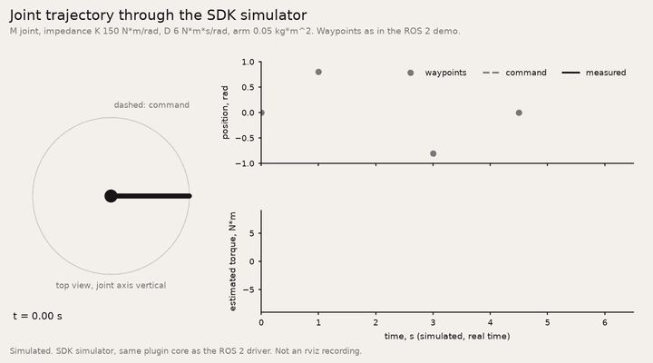

# am-sdk

The host API for Artificial Motion joints. Same calls in C and Python.

Write your controller today against the simulator. Moving to hardware changes one line: the interface.

Evaluation units ship Q1 2027.

All clips below are simulated (the SDK simulator, MuJoCo), not hardware.




Try it without installing anything: [](https://colab.research.google.com/github/artificialmotion/am-sdk/blob/main/notebooks/check_your_actuator.ipynb) "Check your actuator in 2 minutes". (The badge works once the repository is public.)

## What you get

- **C library** (`c/`). C99, no dependencies, builds anywhere CMake runs. A pure codec for people who run their own EtherCAT master, and a session API on top of it.
- **Python package** (`python/`). The same calls, the same simulator, plus EtherCAT and CAN-FD backends and a MuJoCo coupling.
- **Simulator**. Every joint in the family: reflected inertia, backdrive friction, the published torque-speed curves, peak budget, thermal model, CiA 402 state machine, STO and faults. The C and Python simulators are one model, and the tests hold them to the same output.
- **Spec** (`docs/`). The API, the PDO byte layouts and the full object dictionary.
- **ROS 2** (`ros2/`). A `ros2_control` hardware plugin, URDF/xacro macros for every unit, a demo and a Python bridge node, on the simulator. See [docs/ROS2.md](docs/ROS2.md).

## Quickstart: C

```sh
cmake -S c -B c/build
cmake --build c/build
ctest --test-dir c/build
./c/build/impedance_sine
```

```c
#include "am_api.h"

am_session_config cfg = {0};
cfg.interface = "sim:M";              /* one M joint in the simulator */
cfg.cycle_us = 1000;

am_session *s;
am_joint *knee;
am_init(&cfg, &s);
am_open_joint(s, 0, &knee);
am_start(s);
am_set_mode(knee, AM_MODE_IMPEDANCE);
am_enable(knee, 1000);

for (;;) {                            /* your RT thread */
    am_impedance imp = {0};
    imp.q_ref_rad = 0.3;
    imp.kp_Nm_per_rad = 150.0f;
    imp.kd_Nm_s_per_rad = 6.0f;
    am_set_impedance(knee, &imp);
    am_cycle(s, NULL);

    am_telemetry t;
    am_read_telemetry(knee, &t);      /* q, qd, iq, torque, temperatures, status */
}
```

On hardware you keep this code and pass your EtherCAT master or CAN driver in `cfg.transport`. If you run your own master already, use the codec alone: `am_codec_pack_rx1601()` and `am_codec_unpack_tx1a00()` in your cyclic task.

## Quickstart: Python

```sh
pip install -e "python[dev]"
python python/examples/01_impedance_sine.py
```

```python
import am_sdk as am

s = am.am_init(am.AmSessionConfig(interface="sim:M"))
knee = am.am_open_joint(s, 0)
am.am_start(s)
am.am_set_mode(knee, am.AmMode.IMPEDANCE)
am.am_enable(knee, timeout_ms=1000)

for k in range(3000):
    am.am_set_impedance(knee, am.AmImpedance(q_ref_rad=0.3, kp_Nm_per_rad=150.0, kd_Nm_s_per_rad=6.0))
    am.am_cycle(s)
    t = am.am_read_telemetry(knee)
```

On hardware: `interface="ecat:eth0"` with `bus=am.AmBus.ETHERCAT`, or `interface="can:socketcan:can0"` with `bus=am.AmBus.CANFD`. Nothing else changes.

## Torque estimation and collision detection

The joints have no output torque sensor. The SDK estimates joint torque from current, position and temperature with a calibrated model of the motor, friction and gear. It also detects unexpected contact with a momentum observer. Both are open, in C (`am_est.h`) and Python (`am_sdk.estimation`), with the same numbers in both.

Every value is labelled as an estimate, with an uncertainty bound, a confidence value and a quality flag (stick, ambiguous, no temperature). You can add a UKF and a learned residual, and keep them only where they beat the baseline on your data. The collision detector is not a safety function.

```sh
python python/examples/05_torque_estimation_collision.py
```

All of this is simulated today. Accuracy targets are in [docs/ESTIMATION.md](docs/ESTIMATION.md), to be confirmed on hardware.

## Actuator model (any actuator, MuJoCo and Isaac Lab)

`am_sdk.actuator_model` is an open, thermal-aware actuator model that works with any actuator: an AM unit, a catalogue unit or your own. It needs only the standard library.

- **Spec.** A JSON file that any datasheet fits: ratio, torque-speed curves per bus voltage, the rating and its conditions (or `unstated`), a 1-node or 2-node thermal network, friction, inertia, gear efficiency, and optional Kt, resistance and current limit. Every value that does not come from the source is listed as an assumption.
- **Runtime.** A torque limit that depends on speed, temperature and the peak budget. I²R and speed-dependent losses, winding and housing temperatures, derate, trip, duty-cycle statistics and events. About 13 µs per step in CPython on a desktop CPU.
- **MuJoCo.** `MujocoActuatorBank` works on any MJCF from a joint-to-spec mapping. MJCF snippets cover armature, friction and motors.
- **Isaac Lab.** An `IdealPDActuator` subclass, written against the documented API. It is untested on Isaac Lab; its torch core is tested.
- **Shipped specs.** The six AM units, plus five catalogue units at their published face values, with source URLs and `conditions unstated` flags.

```python
from am_sdk.actuator_model import ActuatorModel, load_spec
act = ActuatorModel(load_spec("AM-M"), dt=0.001)
tau = act.step(tau_cmd, omega)            # limited torque; act.state.winding_c, act.events
```

Everything is a simulation model: lumped thermal physics, calibrated to reproduce the datasheet rating under its stated conditions. See [docs/ACTUATOR_MODEL.md](docs/ACTUATOR_MODEL.md) for the method, the assumptions, how to fit your own actuator and the limits of the model. Examples: `python/examples/05_*.py` to `09_*.py`.

## Layers

| Layer | Where | What it does |
|---|---|---|
| Codec | `am_codec_*` | Pure functions. SI units in, PDO bytes out, and back. CiA 402 state walk. No I/O, no allocation. |
| Session | `am_*` | Sessions and joints, modes, enable walk, limits, faults, events. Runs over your transport or the simulator. |
| Python | `am_sdk` | The same calls in Python, with the simulator, EtherCAT, CAN-FD and MuJoCo. |

The wire contract is the CiA 402 object dictionary. Any CiA 402 master drives the joints without this SDK. The SDK makes it faster.

## Buses

- **EtherCAT**, CoE with CiA 402. The main bus. Fixed PDO maps, distributed clocks.
- **CAN-FD**, CANopen FD on the same object dictionary. Standard PDOs, or a compact profile that runs four joints per command frame.

Every joint has both. You pick which one holds control authority.

## Repository

```
c/          C library, simulator, tests, examples (CMake)
python/     Python package am_sdk, tests, examples
docs/       API.md, ESTIMATION.md, object_dictionary.csv, ACTUATOR_MODEL.md, ROS2.md
ros2/       ROS 2 packages: am_ros2_control, am_description, am_ros2_demo, am_ros2_bridge
tools/      unit data, URDF and actuator spec generators, CAN-FD bus budget
```

Run everything:

```sh
cmake -S c -B c/build && cmake --build c/build && ctest --test-dir c/build
cd python && python -m pytest
```

The Python tests include the C cross-check when `c/build` exists.

## Open SDK, closed firmware

The SDK is open source under Apache-2.0. Fork it, ship it, build on it. The joint firmware is not open.

Firmware update and service tools come with the evaluation units.

## Status

Version 0.2.0 in development. The API is stable in shape and can still change before 1.0, which freezes with the first evaluation units. Changes go in [CHANGELOG.md](CHANGELOG.md). What 1.0 freezes, and what stays free to change, is in [docs/API.md 4.7](docs/API.md#47-versioning).

The joints are not built yet. Every unit value in this repository (ratings, curves, inertia, friction, thermal data) is a simulated typical design value, not a measurement, and no accuracy or performance figure here is a specification. Values change to measured ones with the evaluation units.

## Third-party software

am-sdk bundles no third-party code. The core C library and Python package need nothing beyond the C and Python standard libraries. Optional extras install other projects under their own licences:

| Extra or use | Project | Licence |
|---|---|---|
| `[can]` | python-can | LGPL-3.0 |
| `[ecat]` | pysoem | MIT; it bundles SOEM, which has its own licence (GPL-based, with a commercial option). Check it before you ship a product on it |
| `[mujoco]` | MuJoCo | Apache-2.0 |
| `[batch]`, `[pinn]` | NumPy | BSD-3-Clause |
| `BatchActuatorModel` with torch | PyTorch | BSD-3-Clause |
| `[dev]` | pytest | MIT |
| `ros2/` | ROS 2, ros2_control | Apache-2.0 |

`ros2/am_ros2_control/test/mock_ros/` holds small test-only stand-ins for ROS 2 interfaces, written for this repository.

Product names in `python/am_sdk/actuator_model/specs/catalogue/` are trademarks of their owners. Those files carry the vendors' published values for illustration; they are not endorsed or verified by the vendors or by Artificial Motion.

[artificialmotion.com](https://artificialmotion.com)
