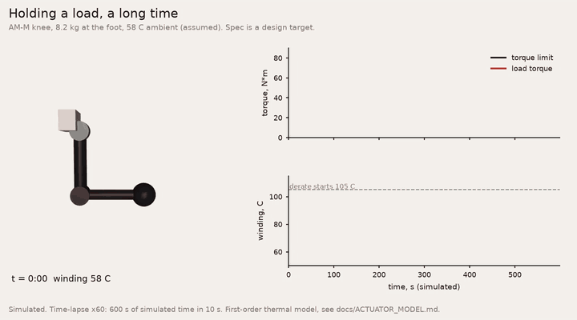

# Actuator model

`am_sdk.actuator_model` is an open, thermal-aware actuator model for MuJoCo, Isaac Lab or your own
simulator. It works with any actuator: an Artificial Motion unit, a catalogue unit, or your own
prototype. You describe the actuator in a JSON spec. The model then gives you, every step:



*Simulated: an AM-M knee (design-target spec) holds 8.2 kg at the foot of a MuJoCo leg in a 58 C ambient (assumed), x60 time-lapse. First-order thermal model. Clips are rendered by `tools/showcase/` (needs matplotlib and imageio-ffmpeg).*

- the torque limit at the current speed and temperature, in both directions
- copper and speed-dependent losses
- winding and housing temperatures from a 1-node or 2-node thermal network
- the peak-duration budget, derating and the over-temperature trip
- duty-cycle statistics and events

Everything here is a simulation model. It is lumped, first-order thermal physics, calibrated so that it
reproduces a datasheet rating under that rating's conditions. It is not a measurement of any actuator.
All Artificial Motion values are design targets for units that have not been built.

The core is standard-library Python. numpy or torch is needed only for the batched model, mujoco only
for the MuJoCo bank, and Isaac Lab only for the Isaac Lab actuator.

## Quick start

```python
from am_sdk.actuator_model import ActuatorModel, load_spec, list_specs

print(list(list_specs()))                 # shipped specs: AM-S-S ... AM-H-X, catalogue examples
act = ActuatorModel(load_spec("AM-M"), dt=0.001, ambient_c=25.0, bus_v=48.0)
for k in range(n):
    tau = act.step(tau_cmd, omega)        # applied output torque after every limit; advances dt
s = act.state                             # winding_c, housing_c, derate, peak_budget_s, tripped, limit_pos_nm, ...
act.duty.summary(); act.events; act.event_counts
```

MuJoCo, on any MJCF with a joint-to-spec mapping:

```python
from am_sdk.actuator_model.mujoco_bridge import MujocoActuatorBank
bank = MujocoActuatorBank(model, data, {"hip": "AM-H-T", "knee": "RobStride-04"})
while running:
    bank.step({"hip": tau_hip, "knee": tau_knee})   # clip, write ctrl or qfrc_applied, mj_step, heat
```

Examples are in `python/examples/05_*.py` to `09_*.py`.

## The spec

The schema is `am-actuator-spec/1`. It is documented in `python/am_sdk/actuator_model/actuator_spec.schema.json`
and checked by `validate_spec()`, which uses only the standard library. All values are at the output shaft.

| Section | Fields |
|---|---|
| identity | `id`, `vendor`, `model`, `status`, `data_revision`, `sources[]` (url, accessed, note), `notes` |
| `mechanical` | `ratio` (or null), `mass_kg`, `reflected_inertia_kgm2`, `gear_efficiency`, `backdrive_nm` |
| `ratings` | `peak_nm`, `peak_duration_s` (null = no budget), `peak_recovery_s_per_s`, `continuous_nm`, `continuous_speed_rad_s`, `nominal_bus_v`, `no_load_speed_rad_s` {bus: rad/s}, `conditions` {`stated`, `ambient_c`, `cooling`, `mount_k_per_w`, `text`} |
| `torque_speed[]` | `bus_v`, `kind` (peak or continuous), `speed_unit` (rpm or rad/s), `points` [[speed, N m], ...] |
| `friction` | `coulomb_nm`, `viscous_nm_s_per_rad`, optional `stribeck` {`static_nm`, `velocity_rad_s`} |
| `electrical` (optional) | `kt_nm_per_a` (motor side, peak-referred), `phase_resistance_ohm` (line-to-neutral), `phase_resistance_ref_c`, `current_limit_a` |
| `thermal` | `model` (1node or 2node), `loss_calibration` (rating or electrical), `rated_winding_c`, `derate_c`, `trip_c`, `trip_hysteresis_k`, `derate_law` (sqrt or linear), `copper_tempco_per_k`, `nodes`, `iron_loss`, `mechanical_losses_heat_actuator` |
| `assumptions[]` | `field`, `value`, `basis`: every value that does not come from the source |

`ratings.conditions.stated` is false when the source does not say under what conditions it rated the
actuator (mount, ambient, duration). Most catalogue pages do not say. In that case the model's
reference conditions are assumptions, and those assumptions are listed.

`thermal.nodes` can be written in either of two forms:

- 1node: `{"tau_s", "c_j_per_k"}` or `{"r_k_per_w", "c_j_per_k"}`.
- 2node: explicit `{"c_winding_j_per_k", "r_winding_housing_k_per_w", "c_housing_j_per_k", "r_housing_ambient_k_per_w"}`,
  or time-constant form `{"tau_housing_s", "tau_winding_s", "winding_rise_fraction", "c_total_j_per_k"}`.
  The time-constant form is converted with these approximations: r_ha = tau_h / C_total,
  r_wh = f / (1 - f) * r_ha, and C_w = tau_w / r_wh.

## Method

### Torque limit

The limit is built in this order:

1. **Curve.** The motoring limit (torque with the same sign as speed) follows the peak curve while peak
   is available, and the continuous curve otherwise. Both are piecewise linear in |speed|, and the limit
   is zero beyond the end of the curve. A braking limit (torque against the motion) is capped at the
   curve's stall value. The simulator in this SDK uses the same convention.
2. **Bus voltage.** A curve published at the requested bus is used exactly. Otherwise the model takes
   the nearest published curve and scales its speed axis by V/V_curve. This back-EMF scaling is an
   approximation.
3. **Current cap.** When `current_limit_a`, `kt_nm_per_a` and `ratio` are all given, the limit is also
   capped at I_max * Kt * N * eta.
4. **Derate.** While the winding is above `derate_c`, peak is no longer available. The limit becomes the
   continuous curve times f:
   - `sqrt` law: f = sqrt((T_derate - T_amb) / (T_w - T_amb)). This holds the winding near T_derate at
     the rated conditions. It is the SDK simulator's law.
   - `linear` law: f falls linearly from 1 at T_derate to 0 at T_trip.
5. **Trip.** At T_w >= `trip_c` the torque is 0. The trip clears when the winding has cooled by
   `trip_hysteresis_k`. Pass `auto_reset_trip=False` to make the clear manual instead.

**Peak budget** (`peak_policy="budget"`, the default). Torque above the continuous curve drains a budget
of `peak_duration_s`. Time below the continuous curve refills it at `peak_recovery_s_per_s`. When the
budget is empty, the continuous curve applies until the budget is back at min(0.5 s, 25 % of the
duration). This is how a datasheet states a peak, for example "2 s from a warm start". With
`peak_policy="thermal"`, the peak curve is always available and only the thermal network and the
derate limit how long it lasts.

### Losses

- Copper: P_cu = k_cu * tau_m^2 * (1 + alpha * (T_w - T_ref)). Here tau_m is the output-referred motor
  torque: |tau| / eta when the actuator drives the load, |tau| * eta when the load back-drives it.
  alpha = 0.00393 1/K for copper.
- Mechanical, speed dependent: P_m = F_c |w| + b w^2 + k1 |w| + k2 w^2 + |tau w| (1/eta - 1). These are
  Coulomb drag, viscous drag, iron loss and the load-dependent gear loss. Set
  `mechanical_losses_heat_actuator` to false to leave them out of the heating.

`k_cu` comes from one of two calibrations:

- `rating` (the default). At the rated point (continuous_nm, continuous_speed) in the rated ambient,
  the steady-state winding temperature equals `rated_winding_c`. With this calibration the model
  reproduces the published continuous rating under the published conditions. The tests check this for
  every shipped spec.
- `electrical`. P_cu = 1.5 R_phase (tau_m / (Kt N))^2, with R taken at `phase_resistance_ref_c`. The
  rating then becomes a check, not an input.

### Thermal network

1-node: C dT_w/dt = P_cu + P_m - (T_w - T_amb) * g / R

2-node: copper loss goes into the winding node and mechanical loss into the housing node:

    C_w dT_w/dt = P_cu - (T_w - T_h) / R_wh
    C_h dT_h/dt = P_m + (T_w - T_h) / R_wh - (T_h - T_amb) * g / R_ha

g is `cooling_scale` (default 1, the rating conditions). For example, 2.0 halves the resistance to
ambient. The equations are integrated with backward Euler, which is unconditionally stable, so 1 kHz
and coarser RL steps both work.

### Duty cycle and events

`act.duty` tracks:

- exponential-window RMS torque over 1, 10 and 60 s
- time above the continuous curve, saturated, derated and tripped
- output and loss energy
- peak events
- maximum winding temperature and maximum torque

The events are `saturation_start/end`, `peak_start/end`, `peak_budget_empty`, `peak_rearmed`,
`derate_start/end`, `trip` and `trip_clear`. Each carries a timestamp. They are stored in `act.events`
(bounded), counted in `act.event_counts`, and passed to an optional `on_event` callback.

### Speed

The scalar model runs at about 13 µs per step on a desktop CPU in CPython. For many environments, use
`BatchActuatorModel` (numpy, or torch on CPU or GPU). It runs the same equations on
(num_envs, num_joints) arrays and counts events per element instead of logging them. The tests hold it
to the scalar model.

## Fitting your own actuator

1. **From a datasheet.** Call `spec_from_datasheet(id=..., rated_nm=..., peak_nm=..., mass_kg=..., ratio=...,
   rated_speed_rpm=..., ...)`. Anything you do not pass is filled from `DEFAULTS` and written to
   `assumptions`:

   | Value | Default | Basis |
   |---|---|---|
   | rating ambient | 25 C | common catalogue reference |
   | winding at the continuous rating | 105 C | the rating is taken as the steady state at the derate threshold |
   | derate / trip / hysteresis | 105 C / 130 C / 5 K | class F/H wire with margin |
   | heat capacity | 600 J/(kg K) x mass | aluminium, steel, copper and magnet mix; order of magnitude |
   | housing time constant | 300 s | order of magnitude |
   | winding-to-housing time constant | 30 s | order of magnitude |
   | share of the rise across winding to housing | 0.5 | |
   | gear efficiency | 0.90 | single-stage planetary order of magnitude |
   | Coulomb friction | 2 % of peak | |
   | viscous friction | 0 | |
   | no-load speed | 1.25 x rated speed | |
   | reflected inertia | 4e-4 kg m^2 per N m of peak | geared quasi-direct-drive order of magnitude |
   | peak duration / recovery | 2 s / 0.1 s per s | |

   Without published curves, the envelope is a straight voltage line through the rated point down to
   zero torque at no-load speed. The peak curve is min(peak, line) and the continuous curve is
   min(rated, line). If no speed is published at all, both curves are flat and no speed limit is
   modelled. The spec records this as an assumption.
2. **Torque-speed curves.** Replace `torque_speed` with dyno points at each bus voltage you use.
3. **Thermal, from a heat run.** Hold a constant torque at stall until the temperature settles, logging
   the winding (and housing) temperature.
   - 1-node: fit T(t) = T_amb + dT (1 - exp(-t/tau)), then R = dT / P and C = tau / R. If you do not know
     P, keep `loss_calibration: "rating"` and use tau only.
   - 2-node: the fast part of the winding curve gives tau_w and the slow part gives tau_h.
   - Run the test at the mount you will use. The mount is part of R.
4. **Electrical.** If you know Kt, phase resistance and the current limit, set them and
   `loss_calibration: "electrical"`.
5. **Friction.** Run a slow constant-velocity sweep in both directions. The intercept is Coulomb, the
   slope is viscous, and a breakaway peak near zero speed gives Stribeck.

`load_spec("my_actuator.json")` loads your file, and `validate_spec(dict)` lists any problems.

## MuJoCo

- `mjcf_snippet(spec, joint)` writes a `<default>` class (joint armature = reflected inertia,
  frictionloss = Coulomb, damping = viscous; motor gear 1, forcerange = ±peak), the joint attribute and
  a `<motor>`. MuJoCo handles friction and inertia natively. `mjcf_defaults_block(specs)` collects the
  classes.
- `MujocoActuatorBank(model, data, {joint: spec})` works with any MJCF that has hinge or slide joints.
  - If the joint has a motor-type actuator, the bank writes `data.ctrl`, respecting gear and gain, and
    widens ctrlrange and forcerange to the peak if they were narrower. Otherwise it writes
    `data.qfrc_applied`.
  - `apply_plant_params=True` copies armature, frictionloss and damping into the model.
  - `explicit_friction=True` applies the spec's friction, including Stribeck, as a torque instead.
  - `install_callback(controller)` runs inside `mjcb_control`, which is process-global.
- The per-unit `<UNIT>_mujoco.xml` files that come with AM units clip at a flat peak. They cannot model
  speed, heating or the peak budget. This bank adds those.

## Isaac Lab (untested on Isaac Lab)

`am_sdk.actuator_model.isaac_lab.make_actuator_cfg(spec_or_{regex: spec}, joint_names_expr, stiffness, damping,
physics_dt)` returns an `AmThermalActuatorCfg`. Its `AmThermalActuator` subclasses Isaac Lab's
`IdealPDActuator`:

- It uses the same PD law, then clips with the batched model on torch and advances the thermal state.
- It fills armature, friction, `effort_limit`, `effort_limit_sim` (peak) and `velocity_limit` from the spec.
- Isaac Lab is imported only when you call it (`isaaclab`, or the older `omni.isaac.lab`).
- `physics_dt` must be the physics step, because Isaac Lab calls `compute()` every physics step.

**Status.** This code was written against the documented Isaac Lab 2.x API and has not been run in Isaac
Lab. The torch core is unit-tested. The glue is tested against a stub of that API only. Check the field
names against your version.

## Limits of this model

- **Lumped thermal.** One or two nodes cannot represent hot spots, axial gradients, the magnet node,
  the power stage or the encoder. A real winding hot spot leads the average. The published rating of an
  AM unit can be bound by something other than the winding: magnet temperature, housing temperature or
  a gear life line. The model maps every rating to one winding-temperature criterion.
- **Rating calibration.** This calibration only guarantees that the continuous rating is reproduced
  under its own conditions. Away from that point the result depends on the assumed split between copper
  and mechanical loss, on the time constants and on the copper tempco. When the conditions are
  `unstated`, the reference conditions themselves are assumed. Two catalogue units can therefore not be
  compared fairly through this model on rating alone.
- **Mount and ambient changes.** `cooling_scale` and `ambient_c` are linear approximations. Convection,
  radiation and mount contact are not linear, and a different mount changes the network, not only one
  conductance.
- **Magnets and voltage.** Kt is constant: magnet weakening with temperature is not modelled. Bus
  scaling of the curves is an approximation.
- **Friction.** Friction is static. Temperature and load dependence of gear friction are not modelled,
  and Coulomb drag and gear efficiency can double-count part of the gear loss.
- **Peak budget.** The peak budget is a datasheet rule and is not derived from physics.

## Shipped specs

Files are in `python/am_sdk/actuator_model/specs/`. `tools/gen_actuator_specs.py` regenerates them.

**AM units (AM-S-S, AM-S-D, AM-M, AM-H-F, AM-H-T, AM-H-X).**

- Source: the per-unit data in `am_sdk/data/<UNIT>/` (the site downloads), the motor design Kt and gear
  efficiency in `am_sdk/units.py`, and the declared rating mount (K/W) published with the rated point.
- These are design targets for units that are simulated and not built.
- The thermal model is 1-node:
  - tau is the published value where one exists (S-S, S-D). Otherwise it is the SDK simulator's
    conservative family value of 210 s, flagged as an assumption.
  - The winding, derate and trip temperatures (105 / 105 / 130 C) are SDK simulator model values, not
    published ratings, and are flagged.
  - The heat capacity, 600 J/(kg K) x mass, is flagged. It scales watts only.

**Catalogue examples.**

| id | Source |
|---|---|
| MyActuator-RMD-X8-P20-150-E | https://myactuator.us/products/rmd-x-series/rmd-x8-p20-150-e-03 (accessed 2026-10-04) |
| MyActuator-RMD-X12-320 | https://aifitlab.com/products/myactuator-rmd-x12-320-motor (reseller, accessed 2026-10-04) |
| CubeMars-AK60-39-V3 | https://www.cubemars.com/product/ak60-39-v3-0-kv80-robotic-actuator.html (accessed 2026-10-04) |
| RobStride-04 | https://www.seeedstudio.com/Robostride-04-Actuator-p-6775.html (reseller, accessed 2026-10-04) |
| Silica-Q-13 | https://www.silicamachines.com/buy (seller "design targets", accessed 2026-10-07) |

- These use only the face values exactly as published: rated torque, peak torque, rated speed, no-load
  speed and ratio where given, mass and bus voltage.
- `conditions.stated` is false for all of them, because their sources do not state rating conditions.
- Every other value comes from the documented defaults and is listed in `assumptions`.
- These files are examples of how to describe a catalogue unit. They are not an assessment of those
  products, and Artificial Motion has not verified them.
- Specifications can change. Check the vendor's current data.
