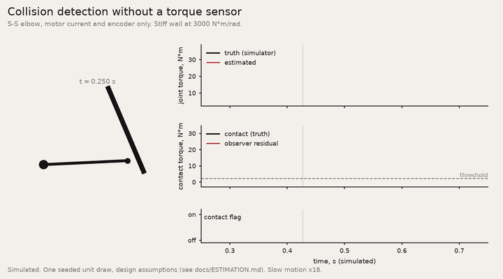

# Torque estimation and collision detection

**Status: simulated, pre-hardware.** Everything on this page runs against the simulator today. No accuracy is claimed until the evaluation units have been measured on a dyno with a reference torque transducer. The numbers under [Targets](#targets) are targets, to be confirmed on hardware. They are not specifications.

**The collision detector is not a safety function.** It does not replace STO or a certified safety controller.



*Simulated: an S-S elbow driven into a stiff wall, slow motion. Clips are rendered by `tools/showcase/` (needs matplotlib and imageio-ffmpeg).*

The joints have no output torque sensor. The SDK estimates joint torque from what the drive already measures (phase current, output position, temperature) and a calibrated model of the motor, friction and gear. It also gives you a collision residual that does not need an acceleration signal. Both are open source, in C and Python, with the same numbers in both.

## What is in the SDK

| | Python (`am_sdk.estimation`) | C (`am_est.h`) |
|---|---|---|
| Calibration record | `EstimatorCalibration` (+ JSON schema) | `am_est_calibration` |
| Design-target record | `EstimatorCalibration.from_unit("M")` | `am_est_calibration_default("M", &cal)` |
| One-sample model | `current_model()` | `am_est_current_model()` |
| Estimator (per joint, per cycle) | `TorqueEstimator.update()` / `.update_from_telemetry()` | `am_est_init()`, `am_est_update()`, `am_est_input_from_telemetry()` |
| Collision observer | `CollisionDetector.update()`, `calibrate_threshold()` | `am_collision_init()`, `am_collision_update()`, `am_collision_calibrate_threshold()` |
| Dither (optional) | `dither_torque()`, `dither_amplitude_max()` | `am_est_dither_torque()`, `am_est_dither_amplitude_max()` |
| UKF (optional) | `UkfTorqueEstimator` | Python only for now |
| Learned residual (optional) | `LinearFeatureResidual`, `adoption_check()`; `pinn.PinnResidual` with `pip install "am-sdk[pinn]"` | Python only |
| Simulator hook | `SimOptions(truth_plant=TruthPlant(...))`, `SimJoint.truth`, `simharness.EstimatorHarness` | Python only |

The core is standard-library Python and allocation-free C99. The C structs are fixed-size; you own the storage. `python/tests/test_cross_check_est.py` runs the same input sequence through both and requires the same outputs.

```python
from am_sdk.estimation import EstimatorCalibration, TorqueEstimator, CollisionDetector, CollisionConfig

cal = EstimatorCalibration.from_joint(joint)            # design values today
est = TorqueEstimator(cal)
det = CollisionDetector(CollisionConfig(inertia_kgm2=cal.reflected_inertia_kgm2 + link_J, threshold_Nm=thr))

am.am_cycle(s)
t = am.am_read_telemetry(joint)
e = est.update_from_telemetry(t)                        # e.tau_out_Nm, e.bound_Nm, e.confidence, e.quality
o = det.update(0.001, t.qd_rad_s, e.tau_drive_Nm, gravity(t.q_rad), e.quality)
if o.onset:
    react()                                             # your reaction: stop, comply, retract
```

Run `python python/examples/05_torque_estimation_collision.py` for the full loop in the simulator, with ground truth next to the estimate. The numbers it prints are simulation results for one simulated unit under the assumptions below.

## The model

Output-referred, rigid gear. `N` is the gear ratio, `w` the output speed, `T` the temperature.

```
tau_m    = N * Kt(T, iq) * iq                                   motor torque before losses
Kt(T, i) = Kt_ref * (1 + a * (T - T_ref)) * (1 - k_sat * (i / i_sat)^2)
f(w, T)  = (Tc + (Ts - Tc) * exp(-(w / ws)^2)) * tanh(w / w_eps) + b * w     (or a measured friction map)
           Tc, Ts scale with (1 + c * (T_f - T)), b with exp(c_b * (T_f - T))
x        = tau_m - f(w, T) - J_arm * qdd                         torque into the gear
tau_out  = s * eta_f * x + (1 - s) * x / eta_r - Tb * tanh(w / w_eps_b)
s        = (1 + tanh(x * w / p_eps)) / 2
```

- `s` blends driving (power flows to the load, `x * eta_f`) and back-driven operation (`x / eta_r`). The efficiencies can be a load x temperature grid.
- `w` and `qdd` come from a second-order state-variable differentiator on the output position (40 Hz, damping 0.8). The output is filtered at 100 Hz by default.
- `tau_out` is the estimated torque delivered at the output flange. `tau_drive` is the same without the armature inertia term; the collision observer uses it.
- Temperature: the magnet temperature from telemetry when the extended fields are fresh, else the winding temperature. Without either, Kt is taken at its reference temperature and the estimate is flagged.

## Quality, bound and confidence

Every estimate carries a quality bit field (`EST_*` in Python, `AM_EST_Q_*` in C):

| Bit | Name | Meaning |
|---|---|---|
| 0 | STICK | The joint is at rest. The torque is only known to within the stick band. |
| 1 | AMBIGUOUS | Stribeck region, or the first 20 ms after leaving stick: the friction level is uncertain. |
| 2 | NO_TEMPERATURE | No temperature input. Kt at its reference temperature, wider bound. |
| 3 | SATURATED | Current beyond the Kt saturation calibration point. |
| 4 | INVALID | Inputs held, stale or not finite. Confidence 0. |
| 5 | DITHER | Dither active. The estimate is the dither-period average (5 Hz filter). |

`bound_Nm` is a model-based uncertainty half-width, about two sigma under the stated uncertainties of the calibration record:

- **Moving:** the root-sum-square of the Kt error, the temperature error times the Kt coefficient, the friction error, the efficiency error and the inertia error, each applied to its own term.
- **STICK:** the moving bound plus the stick band. At rest, any torque between `(tau_m - Ts) * eta_f` and `(tau_m + Ts) / eta_r` is consistent with zero speed. The half-width of that range is the stick band.
- **AMBIGUOUS:** the moving bound plus half the stick band.

`confidence = 1 - bound / (0.1 * rated torque)`, clipped to 0..1. It is a convenience scale, not a probability.

Outputs are labelled `"estimated"`. Do not log or display them as measured torque.

## Collision observer

For one joint with total inertia `J` (armature plus your link model), the generalised momentum `p = J * qd` obeys `dp/dt = tau_drive + tau_known + tau_contact`. The observer

```
r_k = K * (p_k - p_0 - sum (tau_drive + tau_known + r_{k-1}) * dt)
```

follows `tau_contact` through a first-order lag of bandwidth `K` (30 Hz default) without differentiating the velocity.

- `tau_known` is what your model explains: gravity, coupling from other joints, a held payload.
- Use the drive's velocity (telemetry `qd_rad_s`) for `qd`. It lags less than the estimator's differentiator.
- A collision is flagged when `|r|` exceeds the threshold. The threshold is doubled while the estimator reports STICK or AMBIGUOUS. The flag clears below half the threshold after 50 ms.

The threshold is yours to set. Record `r` over the contact-free motions your robot will run and use `calibrate_threshold(residuals)` (1.1 x the largest |r|). A better link model gives a lower threshold. The threshold seen at the contact point is `threshold / lever arm`.

## UKF and learned residuals

`UkfTorqueEstimator` runs a 3-state unscented Kalman filter (angle, speed, gear torque) on the same physics, with the motor encoder as the measurement. A learned residual adds the loss the physics model misses:

- `LinearFeatureResidual`: ridge regression on physics-structured features. Standard library only.
- `pinn.PinnResidual`: a small MLP whose training loss includes a passivity term (the gear cannot feed power into the joint). Needs numpy.

Both train on dyno points: steady speed, a reference torque, temperature and current (`residual_targets()`). **Adopt a residual or the UKF on a joint only where it beats the baseline on held-out dyno data.** `adoption_check()` gives the comparison, and its default rule is at least 10 % lower RMS error. In our pre-hardware simulation the UKF helped while moving and did not help at standstill. Simulation cannot show what learning adds; the evaluation-unit dyno decides.

## Dither (optional, off by default)

At standstill the gear can hold any torque inside the stick band. A small sinusoidal torque dither keeps the gear moving microscopically, so a static load becomes observable. `dither_torque()` caps the amplitude at min(1.5 x breakaway, 10 % of rated). Add it to your torque feed-forward and set `dither_active`. It costs a small vibration and some heat. A firmware dither mode is planned with the evaluation units.

## Calibration record

`am_est_cal_v1`, schema in `python/am_sdk/estimation/estimator_calibration.schema.json`. The C struct `am_est_calibration` has the same fields; maps are fixed arrays with the counts alongside.

| Fields | Object on the unit |
|---|---|
| `kt_Nm_per_A`, `kt_ref_temp_C`, `kt_temp_coeff_per_K` | 0x2200:2..4 |
| `gear_ratio` | 0x2200:13 / 0x2220:1 |
| `coulomb_Nm`, `viscous_Nm_s_per_rad`, `breakaway_Nm`, `stribeck_vel_rad_s`, temperature coefficient | 0x2220:4 |
| `cal_epoch` and the host model id / version / hash | 0x2230:1..4 |
| friction map, efficiency grid, saturation, uncertainties | end-of-line record, delivered with the evaluation units |

Today every record is `design_target` (from the published unit data, with an assumed friction shape and reverse efficiency) or `simulated`. End-of-line records are measured per unit and will be delivered with the evaluation units: moving friction map, static stick band, efficiency against load and temperature, Kt against temperature and saturation.

## Running it in the simulator

The default simulator plant has Coulomb friction and no gear loss, which makes the estimator look better than it is. For estimator work, give the joint a richer plant:

```python
plant = am.TruthPlant(coulomb_Nm=0.45, breakaway_Nm=0.65, viscous_Nm_s_per_rad=0.04,
                      eta_forward=0.935, eta_reverse=0.861, kt_scale=1.02, i_offset_A=0.015, i_noise_A=0.03)
cfg = am.AmSessionConfig(interface="sim:S-S", sim_options=[am.SimOptions(truth_plant=plant, load_inertia_kgm2=0.06)])
```

`SimJoint.truth` then holds the ground truth of each cycle: the torque at the output flange, the external torque, the motor torque and the acceleration. `simharness.EstimatorHarness` steps the session and logs the truth next to each estimate and collision flag. `simharness.study_truth_plant()` draws one simulated S-S or S-D unit with spread and field drift away from the nominal calibration, so you see the errors a fixed calibration meets. The truth plant is in the Python simulator only. Without it, the simulator is unchanged and the C/Python simulator cross-check still holds.

## Targets

**Targets, to be confirmed on hardware.** They come from our pre-hardware simulation and will be published as figures only after the evaluation-unit dyno.

| Quantity | Target |
|---|---|
| Joint torque, moving | about ±3 % of rated |
| Joint torque, static | ±(breakaway + 10 % of load) |
| Estimate bandwidth | about 30 Hz |
| Collision detection | under 10 N at the contact, within 10 ms (with a link model) |

## Assumptions and limitations

- Rigid gear. Gear compliance, backlash and the twist between motor and output are not modelled. The study plant that set the targets had them; the SDK's `TruthPlant` does not.
- The friction and efficiency model is the dominant uncertainty. The parametric shape is assumed until measured. Field drift (run-in, grease, temperature) moves it after calibration.
- The momentum observer treats the gear efficiency as 1 on the armature inertia term. The error scales with `(1 - eta) * J_arm * qdd`.
- Static torque is only known to within the stick band unless you dither.
- Single joint. Coupling from other joints belongs in your `tau_known`.
- Python runs on the host clock. On our development PC the baseline estimator takes about 40 µs per update and the UKF about 250 µs. Run hardware loops in C.
- Simulated results depend on the plant assumptions. They show how the method behaves, not how a unit performs.
